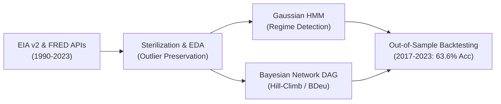

# Crude Oil Regime Detection & Probabilistic Graphical Risk Modeling

[](https://www.python.org/)
[](https://pgmpy.org/)
[](https://opensource.org/licenses/MIT)

An end-to-end quantitative risk management system analyzing 33+ years (1990–2023) of WTI crude oil market dynamics. The framework couples **Gaussian Hidden Markov Models (HMM)** for market regime detection with **Bayesian Network Directed Acyclic Graphs (DAG)** for causal macro structure learning and out-of-sample directional forecasting.

*Replication and empirical extension of Danish A. Alvi's UCL research (2018).*

---

> ### 💡 Executive Summary (In Plain English)
> 
> * **The Challenge:** Traditional quantitative models (linear regression, moving averages, or black-box neural nets) struggle with energy markets because oil prices suffer extreme, non-linear spikes driven by supply shocks and geopolitical events. Black-box models output predictions without explaining *why*.
> * **The Solution:** We built a two-stage probabilistic framework:
>   1. **Hidden Markov Models (HMM):** Act as the market's "thermometer", decoding hidden states (Bull/Stable vs. Bear/Crisis) directly from return volatility.
>   2. **Bayesian Causal Networks (DAGs):** Act as a "market map", discovering cause-and-effect relationships between producer costs, OPEC supply decisions, currency fluctuations, and spot prices.
> * **The Outcome:** The model achieved **63.64% directional accuracy** on unseen data (2017–2023) across major crises (2020 COVID crash, 2022 geopolitical shock) — beating a random 33.3% baseline by **+30.3%**. It gives risk managers a "glass-box" view so they can audit the economic reason behind every alert before committing capital.

---

## 📊 Key Highlights & Empirical Results

| Metric | Result | Economic Meaning |
| :--- | :--- | :--- |
| **Out-of-Sample Accuracy** | **63.64%** | Outperformed random baseline (33.3%) by +30.3% across the volatile 2017–2023 test window. |
| **Regime Volatility Ratio** | **12.2x** | Crisis states ($\sigma^2 = 0.065$) exhibit 12.2x higher variance than Stable states ($\sigma^2 = 0.005$). |
| **Crisis Persistence** | **77.1%** | Once a bear/crisis regime starts, it is "sticky" (77.1% self-transition probability). |
| **Stability Persistence** | **98.4%** | Stable regimes act as the steady default state of the energy market. |
| **Key Causal Driver** | **PPI $\rightarrow$ WTI** | Model independently identified Producer Price Index (`PCU211211`) as a direct cost floor for spot prices. |

---

## 🏗️ Architecture Pipeline



### Phase 1: Ingestion & Factor Pipeline (1990–2023)
- Automated ingestion pipeline extracting 33+ years of data via **EIA API v2** (STEO) and **FRED API**.
- Harmonized daily financial figures with monthly macroeconomic indicators (month-end alignment).
- Implemented data sterilization protocols: forward-fill imputation and **tail-event preservation** (Z-Score > 3). Extreme events like the 2008 Global Financial Crisis and 2020 COVID oil plunge were deliberately retained so the model learns real crisis signatures.

### Phase 2: Regime Detection & Structure Learning
- **Gaussian HMM:** Forward-Backward algorithm for smoothing, Baum-Welch (Expectation-Maximization) for parameter learning, and Viterbi algorithm for optimal hidden state path reconstruction.
- **Structure Learning:** Score-based Directed Acyclic Graph (DAG) construction using `pgmpy` Hill-Climb search with Bayesian Information Criterion (BIC) and Bayesian Dirichlet equivalent uniform (BDeu) scoring.

### Phase 3: Backtesting, Validation & Risk Inference
- **Chronological Data Split (Zero Lookahead Bias):**
  - *Training Set:* 1990–2014 (~73% of history, 300 monthly samples)
  - *Validation Set:* 2015–2016 (hyperparameter selection & post-2014 crash transition)
  - *Out-of-Sample Test Set:* 2017–2023 (extreme stress conditions: COVID-19, 2022 geopolitics, high inflation)
- Discretized returns into 3 regimes (Bear, Neutral, Bull) and evaluated conditional probabilities via Variable Elimination.

---

## 📈 Macroeconomic Feature Dictionary

| Ticker / Code | Source | Economic Role |
| :--- | :--- | :--- |
| `WTISPLC` | FRED | **WTI Spot Crude Oil Price** (Target variable) |
| `PCU211211` | FRED | **Producer Price Index (Crude Extraction)** — acts as cost basis & price floor |
| `STEO.PAPR_OPEC.M` | EIA | **OPEC Crude Oil Production** — cartel physical supply volumes |
| `STEO.COPS_OPEC.M` | EIA | **OPEC Surplus Crude Oil Production Capacity** — market buffer |
| `STEO.PAPR_NONOPEC.M` | EIA | **Non-OPEC Production** (e.g. US Shale, Russia) |
| `STEO.PATC_OECD.M` | EIA | **OECD Petroleum Consumption** — global demand proxy |
| `DTWEXBGS` | FRED | **Trade-Weighted U.S. Dollar Index** — currency denomination pressure |
| `INDPRO` | FRED | **U.S. Industrial Production Index** — macroeconomic expansion/contraction proxy |
| `CPIENGSL` | FRED | **Energy Consumer Price Index (CPI)** — inflation pressure |
| `STLFSI2` | FRED | **St. Louis Fed Financial Stress Index** — systemic market fear & liquidity gauge |

---

## 📂 Repository Structure

```
crude-oil-bayesian-risk-modeling/
│
├── README.md                              # Flagship documentation & results
├── requirements.txt                       # Core Python dependencies
├── .gitignore                             # Ignored cache & temporary files
├── .env.example                           # Template for EIA / FRED API keys
│
├── notebooks/                             # Research & Modeling Notebooks
│   ├── 01_data_ingestion_eda.ipynb        # Phase 1: API ETL, cleaning & outlier EDA
│   ├── 02_regime_detection_hmm_dag.ipynb  # Phase 2: HMM regime detection & DAG structure
│   └── 03_validation_forecasting_eval.ipynb # Phase 3: Backtest, accuracy & risk evaluation
│
└── reports/                               # Full Written Academic Reports
    ├── Phase_1_Data_Pipeline.pdf
    ├── Phase_2_Methodology_HMM_DAG.pdf
    └── Phase_3_Validation_Forecasting.pdf
```

---

## 🚀 Quickstart & Setup

1. **Clone the repository:**
   ```bash
   git clone https://github.com/ahmedw47/crude-oil-bayesian-risk-modeling.git
   cd crude-oil-bayesian-risk-modeling
   ```

2. **Install dependencies:**
   ```bash
   pip install -r requirements.txt
   ```

3. **Configure API Keys:**
   ```bash
   cp .env.example .env
   # Add your free FRED and EIA v2 API keys in .env
   ```

4. **Run Notebooks in Sequence:**
   ```bash
   jupyter notebook notebooks/01_data_ingestion_eda.ipynb
   ```

---

## 👤 Author

* **SK Wasim Ahmed**
* **Institution:** WorldQuant University — MSc in Financial Engineering (MScFE)
* **GitHub:** [@ahmedw47](https://github.com/ahmedw47)
* **Email:** [ahmedw47@gmail.com](mailto:ahmedw47@gmail.com)

---

## 📚 References

- Alvi, Danish A. *Application of Probabilistic Graphical Models in Forecasting Crude Oil Price.* UCL Dissertation, 2018. [arXiv:1804.10869](https://arxiv.org/abs/1804.10869).
- Koller, Daphne, and Nir Friedman. *Probabilistic Graphical Models: Principles and Techniques.* MIT Press, 2009.
- Ankan, Ankur, and Johannes Textor. *pgmpy: A Python Toolkit for Bayesian Networks.* JMLR, 2024.
