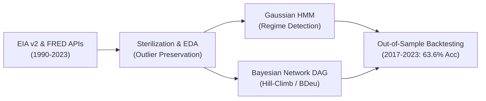

# Crude Oil Regime Detection & Probabilistic Graphical Risk Modeling

[](https://www.python.org/)
[](https://pgmpy.org/)
[](https://opensource.org/licenses/MIT)

An end-to-end quantitative risk management system analyzing 33+ years (1990–2023) of WTI crude oil market dynamics. The framework couples **Gaussian Hidden Markov Models (HMM)** for market regime detection with **Bayesian Network Directed Acyclic Graphs (DAG)** for causal macro structure learning and out-of-sample directional forecasting.

*Replication and empirical extension of Danish A. Alvi's UCL research (2018).*

---

## Key Highlights & Empirical Results

- **63.64% Out-of-Sample Accuracy:** Outperformed a random 3-state benchmark (33.3%) by **+30.3%** on an unseen test period (2017–2023) marked by the 2020 COVID oil crash and 2022 geopolitical shocks.
- **Regime Volatility Disparity:** Identified a **12.2x variance multiple** between Crisis regimes ($\sigma^2 = 0.065$) and Stable regimes ($\sigma^2 = 0.005$).
- **Regime Persistence:** Learned state transition matrices confirmed that crises are "sticky" with a **77.1% self-transition probability**, whereas stability exhibits a 98.4% retention rate.
- **Causal Discovery:** Hill-Climbing with discrete BDeu scoring discovered direct dependencies: Producer Price Index (PPI `PCU211211`) serves as an empirical price floor for WTI spot prices, while Non-OPEC output directly shapes OPEC capacity dynamics.
- **Glass-Box Interpretability:** Exploits Markov Blankets to isolate direct drivers, removing black-box ambiguity for risk managers and regulators.

---

## Architecture Pipeline



### Phase 1: Ingestion & Factor Pipeline (1990–2023)
- Automated ingestion from **EIA API v2** (STEO) and **FRED API**.
- Features: WTI Spot Price, OPEC & Non-OPEC Production, OECD Inventories, US CPI, Industrial Production (`INDPRO`), Financial Stress Index (`STLFSI`), and US Dollar Index (`DTWEXBGS`).
- Data sterilization: Frequency synchronization to month-end, forward-fill imputation, and tail-event preservation (Z-Score > 3 retained to avoid false security in risk modeling).

### Phase 2: Regime Detection & Structure Learning
- **Gaussian HMM:** Forward-Backward algorithm for smoothing, Baum-Welch (EM) for parameter learning, and Viterbi algorithm for optimal regime path decoding.
- **Structure Learning:** Score-based Directed Acyclic Graph (DAG) construction using `pgmpy` Hill-Climb search with Bayesian Information Criterion (BIC) and BDeu scores.

### Phase 3: Backtesting, Validation & Inference
- **Chronological Data Split:**
  - *Training:* 1990–2014 (~73% of history)
  - *Validation / Tuning:* 2015–2016 (post-2014 crash transition)
  - *Testing (Out-of-Sample):* 2017–2023 (extreme stress conditions: COVID-19, 2022 geopolitics, inflation)
- Discretization into 3 regimes (Bear, Neutral, Bull) and conditional probability evaluation via Variable Elimination.

---

## Repository Structure

```
crude-oil-bayesian-risk-modeling/
│
├── README.md                              # Project overview & documentation
├── requirements.txt                       # Python dependencies
├── .gitignore                             # Ignored cache & temporary files
├── .env.example                           # Template for EIA / FRED API keys
│
├── notebooks/                             # Research notebooks
│   ├── 01_data_ingestion_eda.ipynb        # Phase 1: Data ingestion & EDA
│   ├── 02_regime_detection_hmm_dag.ipynb  # Phase 2: HMM regime detection & DAGs
│   └── 03_validation_forecasting_eval.ipynb # Phase 3: Out-of-sample forecasting
│
└── reports/                               # Full written academic reports
    ├── Phase_1_Data_Pipeline.pdf
    ├── Phase_2_Methodology_HMM_DAG.pdf
    └── Phase_3_Validation_Forecasting.pdf
```

---

## Installation & Setup

1. **Clone the repository:**
   ```bash
   git clone https://github.com/your-username/crude-oil-bayesian-risk-modeling.git
   cd crude-oil-bayesian-risk-modeling
   ```

2. **Install dependencies:**
   ```bash
   pip install -r requirements.txt
   ```

3. **Configure API Keys:**
   ```bash
   cp .env.example .env
   # Add your free FRED and EIA v2 API keys in .env
   ```

4. **Run the Notebooks:**
   Launch Jupyter and run notebooks in order:
   ```bash
   jupyter notebook notebooks/01_data_ingestion_eda.ipynb
   ```

---

## References

- Alvi, Danish A. *Application of Probabilistic Graphical Models in Forecasting Crude Oil Price.* UCL Dissertation, 2018. [arXiv:1804.10869](https://arxiv.org/abs/1804.10869).
- Koller, Daphne, and Nir Friedman. *Probabilistic Graphical Models: Principles and Techniques.* MIT Press, 2009.
- Ankan, Ankur, and Johannes Textor. *pgmpy: A Python Toolkit for Bayesian Networks.* JMLR, 2024.
